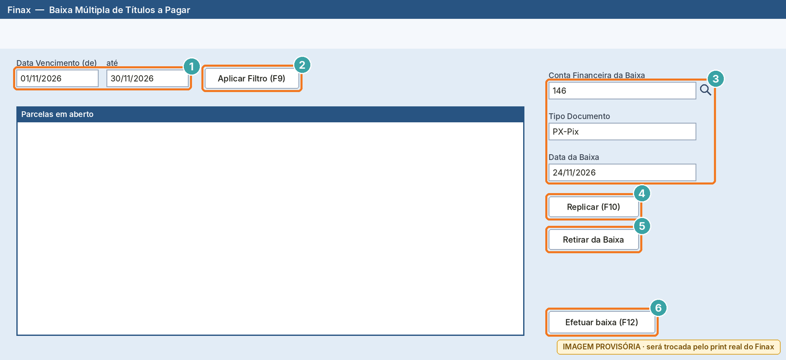

# Como baixar várias parcelas de uma vez

A **Baixa múltipla** paga de uma só vez todas as parcelas em aberto de um período.

**Abrir:** menu **Pagar > Baixa múltipla de títulos a pagar** (ou ícone **Baixa Múltipla Pag.** na aba Contas à Pagar).

<figure class="tela" markdown>

<figcaption>Tela de Baixa Múltipla de Títulos a Pagar.</figcaption>
</figure>

## Passo a passo

1. 1 Em **Data Vencimento**, informe o período (de/até) pelo calendário. Se quiser, filtre por Favorecido, Conta Financeira ou Credor/Fornecedor.
2. 2 Clique em **Aplicar Filtro** (++f9++). A grade lista as parcelas em aberto do período.
3. 3 No painel da direita, preencha **Conta Financeira da Baixa**, **Tipo Documento** e **Data da Baixa**.
4. 4 Clique em **Replicar** (++f10++). A data e o tipo de documento são copiados para todas as linhas, e a tela mostra a quantidade e o valor total a baixar.
5. 5 (Opcional) Para deixar uma parcela de fora, clique na linha e em **Retirar da Baixa**. Confirme com **Sim**.
6. 6 Clique em **Efetuar baixa** (++f12++) e confirme **Sim**.

## Resultado

O log no rodapé da tela confirma cada título (*"Título baixado! Número(xxxx)"*) e termina com *"Fim do processo de baixa de títulos. (n) título(s) baixado(s)!"*.

!!! note
    - Títulos **vinculados** não aparecem na grade.
    - Retirou uma linha por engano? Clique em **Aplicar Filtro** de novo para ela voltar.
    - O botão **Insere Títulos** permite buscar outros títulos por número, nota fiscal, fornecedor ou favorecido.
