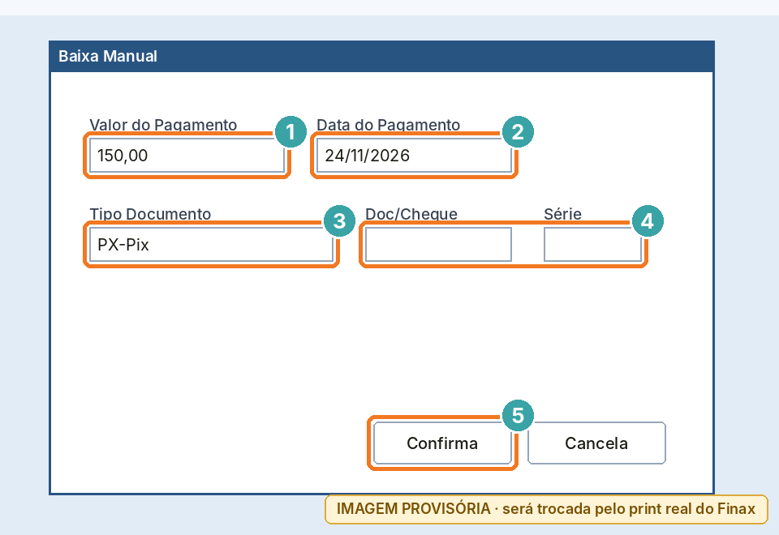

# Como baixar (pagar) uma parcela

**Baixar** é registrar no Finax que a parcela foi paga.

## Passo a passo

1. Abra o título e use as setas da barra de parcelas para escolher a parcela.
2. Clique em **Baixa** (++f4++). Abre a janela **Baixa Manual**.

<figure class="tela" markdown>

<figcaption>Janela Baixa Manual.</figcaption>
</figure>

Na janela, preencha:

1. 1 **Valor do Pagamento**: já vem com o valor da parcela.
2. 2 **Data do Pagamento**: clique na setinha e escolha a data (ou **Hoje** no calendário).
3. 3 **Tipo Documento**: CH-Cheque, DN-Dinheiro, IB-Internet, DC-Déb.Conta, PM-Permuta ou PX-Pix.
4. 4 **Doc/Cheque** e **Série**: preencha se aplicável (ex.: número do cheque).
5. 5 Clique em **Confirma**.

## Resultado

O status da parcela passa a **Baixado** (em verde) e o quadro **Informações da Baixa** mostra valor pago, data, tipo de documento, forma de baixa (M = manual), data/hora e operador. Os campos de valor da parcela ficam bloqueados.

## Desfazer a baixa

1. Com a parcela baixada na tela, clique em **Retira baixa do Título** (++f5++).
2. O sistema mostra *"Título desbaixado com sucesso!"*. Clique em **OK**.

A parcela volta a ficar em aberto e o quadro Informações da Baixa fica vazio.

!!! tip "Várias parcelas de uma vez"
    Para pagar muitas parcelas juntas, use a [Baixa múltipla](baixa-multipla.md).
