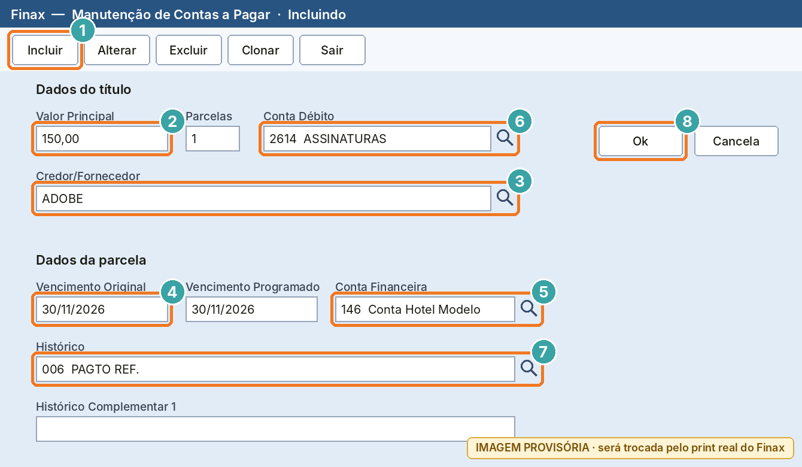

# Como incluir um título a pagar

Cadastre uma despesa de **uma parcela** (por exemplo, uma assinatura mensal de R$ 150,00). Para dividir em várias parcelas, veja [Incluir um título parcelado](titulo-parcelado.md).

▶ **Vídeo: Como incluir um título a pagar** (2 min)

O vídeo do YouTube entra aqui, no lugar deste quadro.

!!! info "Antes de começar"
    A empresa precisa ter Conta Financeira, Credor/Fornecedor, Plano de Contas e Histórico Padrão cadastrados. Veja [Cadastros necessários](index.md#antes-de-comecar-cadastros-necessarios).

## Passo a passo

<figure class="tela" markdown>

<figcaption>Os números da imagem correspondem aos passos abaixo. Clique para ampliar.</figcaption>
</figure>

1. 1 Abra a [Manutenção de Contas a Pagar](index.md#como-abrir-a-tela) e clique em **Incluir** (ou ++alt+i++). O modo muda para **Incluindo** e o sistema atribui o número do título.
2. 2 Em **Valor Principal**, digite o valor (ex.: 150,00) e pressione ++tab++. Moeda, Parcelas (1) e Mês/Ano de competência já vêm preenchidos.
3. 3 Em **Credor/Fornecedor**, clique na lupa. Na pesquisa, digite parte do nome em **Valor Campo** ou procure na lista e dê **duplo clique** no credor. O Favorecido Cheque é preenchido sozinho.
4. 4 O **Vencimento Original** vem com a data de hoje. Para mudar, clique na setinha e escolha o dia no calendário. O Vencimento Programado acompanha.
5. 5 Em **Conta Financeira**, clique na lupa e dê duplo clique na conta (ex.: 146).
6. 6 Em **Conta Débito**, ao lado de Moeda, clique na lupa e dê duplo clique na conta contábil (ex.: 2614 ASSINATURAS).
7. 7 Em **Histórico**, clique na lupa e dê duplo clique no histórico padrão (ex.: 006 PAGTO REF.).
8. 8 (Opcional: preencha Número da NF, Histórico Complementar 1 etc.) Clique em **Ok** para gravar.

## Depois de gravar

A tela abre sozinha um **novo registro em branco** (próximo número), ainda em modo Incluindo. Se não quiser incluir outro título, clique em **Cancela**: a tela volta ao título que você acabou de gravar.

!!! note "Por que a numeração pula?"
    Cada registro em branco aberto consome um número de título. Por isso é normal a numeração pular quando você clica em Cancela.

## Se aparecer uma mensagem

| Mensagem | O que fazer |
|---|---|
| A Conta informada não foi encontrada ou não está ativada! | Preencha a Conta Financeira. Se a lista estiver vazia, cadastre a conta antes. |
| Campo "Conta Débito" deve ser preenchido! | Escolha a conta contábil pela lupa. |
| Campo Historico Padrão deve ser preenchido! | Escolha o histórico pela lupa. |
| A data informada refere-se a um dia não útil! | É só um aviso: o vencimento cai em fim de semana ou feriado. Ajuste se quiser. |

Veja todas em [Mensagens do sistema](../mensagens.md).

## Veja também

- [Incluir um título parcelado](titulo-parcelado.md)
- [Ratear o valor em várias contas (Itens)](itens.md)
- [Baixar (pagar) uma parcela](baixar-parcela.md)
