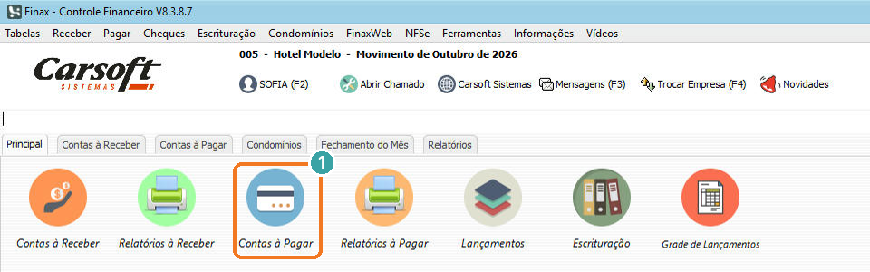
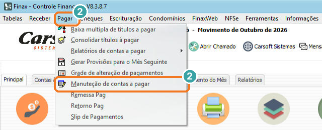

# Contas a Pagar

O módulo **Contas a Pagar** guarda as despesas da empresa (os **títulos**) e controla o pagamento de cada **parcela**. Nesta página você conhece a tela principal. Os procedimentos estão nos artigos ao lado.

## Como abrir a tela

Há dois caminhos:

1. 1 Na tela principal, aba **Principal** (ou aba **Contas à Pagar**), clique no ícone **Contas à Pagar**.

<figure class="tela" markdown>

</figure>

2. 2 Ou, no menu superior, clique em **Pagar > Manutenção de contas a pagar**.

<figure class="tela" markdown>

</figure>

A tela abre em modo **Consultando** (somente leitura). A parte de baixo da janela mostra o modo atual: **Consultando**, **Incluindo** ou **Editando**. Para fechar, use o botão **Sair** ou o X da janela.

## Conhecendo a tela

**Barra de botões (topo):** Incluir, Alterar, Excluir, Primeiro, Anterior, Próximo, Último, Imprimir, Sair, Acha (localizar), Clonar, CSV, Vincular e Log. O campo **Consulta**, no canto direito, localiza um título.

**Dados do título (parte de cima):** Nº Título, Empresa e Operador (preenchidos pelo sistema); Moeda, Valor Principal e Parcelas; Conta Débito (conta contábil da despesa); Número da NF, Data de Emissão NF, Mês/Ano Competência e Provisão; Credor/Fornecedor; as caixas Baixar Automaticamente e Gera Provisão Contábil; o quadro Serviço / Reinf e os botões **Itens** e **Documentos**.

**Dados da parcela (parte de baixo):** número da parcela, Valor a Pagar, Vencimento Original e Programado, Conta Financeira, Favorecido, Histórico e Históricos Complementares, o quadro **Informações da Baixa** e o **Status da parcela**.

### Barra de parcelas

As setas navegam entre as parcelas. Os ícones também têm teclas de atalho:

| Tecla | Função |
|---|---|
| ++f2++ | Imprime recibo do título |
| ++f3++ | Imprime cheque |
| ++f4++ | **Baixa** (pagamento) |
| ++f5++ | **Retira a baixa** do título |
| ++f6++ | Emite cópia |
| ++f7++ | Transfere o título de empresa |
| ++f8++ | Imprime nota de compras |

## Antes de começar: cadastros necessários

Para gravar um título, estes cadastros precisam existir na empresa:

- **Conta Financeira**: aba Condomínios > ícone Contas Financeiras.
- **Credor/Fornecedor**: cadastro de pessoas.
- **Plano de Contas**: usado no campo Conta Débito (aba Condomínios > Plano de Contas).
- **Histórico Padrão**: usado no campo Histórico.

## Neste módulo

- [Incluir um título](incluir-titulo.md) · [Título parcelado](titulo-parcelado.md) · [Alterar](alterar-titulo.md) · [Itens (rateio)](itens.md) · [Documentos](documentos.md) · [Clonar](clonar-titulo.md) · [Excluir](excluir-titulo.md)
- [Baixar uma parcela](baixar-parcela.md) · [Baixa múltipla](baixa-multipla.md) · [Consolidar títulos](consolidar.md)
- [Provisões mensais](provisoes.md)
