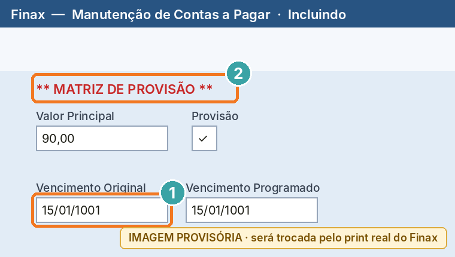

# Provisões mensais

Uma **provisão** é uma despesa que se repete todo mês, como aluguel ou assinatura. Você cadastra **uma vez** um título-modelo, a **matriz de provisão**, e depois o Finax gera os títulos dos meses seguintes a partir dele.

## 1. Cadastrar a matriz de provisão

É um título comum, cadastrado como em [Incluir um título](incluir-titulo.md), com **uma regra especial no vencimento**: o dia correto, o **mês 01** e o **ano 1001**.

!!! example "Exemplo"
    Despesa que vence todo dia 15 → vencimento da matriz **15/01/1001**.

<figure class="tela" markdown>

<figcaption>Com o vencimento dd/01/1001, o título vira matriz.</figcaption>
</figure>

1. Clique em **Incluir** e preencha Valor Principal, Credor, Conta Débito, Conta Financeira e Histórico. O valor informado é o que será repetido todo mês.
2. No **Vencimento Original** (destaque 1 na imagem), clique sobre a parte do **dia** e digite os números **15011001** (sem barras). Pressione ++tab++.
3. O aviso **\*\* MATRIZ DE PROVISÃO \*\*** aparece no cabeçalho e a caixa **Provisão** é marcada sozinha (destaque 2).
4. Clique em **Ok** para gravar e em **Cancela** para sair do registro em branco.

!!! warning
    Não basta marcar a caixa **Provisão**: sem a data dd/01/1001 o título **não** vira matriz.

## 2. Gerar as provisões do mês seguinte

**Abrir:** menu **Pagar > Gerar Provisões para o Mês Seguinte** (ou ícone **Gera Provisões** na aba Contas à Pagar).

1. Clique em **Ver Matrizes** e confira se a sua matriz está na lista. Clique em **OK**.
2. Confira a **Empresa** e o período (**Ano/Mês Inicial** e **Final**). A tela já abre com o mês seguinte.
3. Clique em **Gerar** e confirme **Sim**.
4. O **Log de operações** mostra uma linha para cada título gerado. No final, clique em **OK**.

**Resultado:** um título novo com o mesmo credor, valor e contas da matriz, **vencendo no dia da matriz e no mês do período** (ex.: 15/12/2026), com a caixa Provisão marcada. A matriz continua igual e serve para os próximos meses.

## 3. Excluir as provisões geradas

Use quando gerou no mês errado. **A matriz não é apagada**, só os títulos gerados no período.

1. Na tela de Geração de Provisões, confira a empresa e o período.
2. Clique em **Excluir Títulos**.
3. Na pergunta *"Encontrado(s) (n) registro(s), Deseja excluir estes títulos?"*, clique em **Sim**.

Depois é possível clicar em **Gerar** de novo para recriar as provisões do período.

!!! question "Apareceu \"Não há Provisões a gerar para as datas selecionadas\"?"
    Não existe matriz cadastrada. Cadastre a matriz com vencimento dd/01/1001 (item 1 acima).
